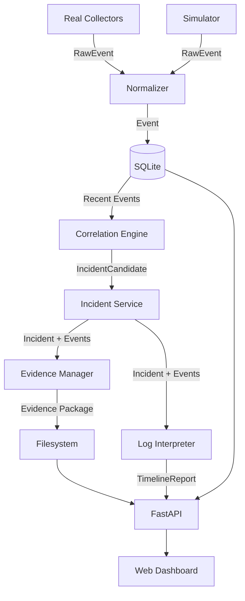
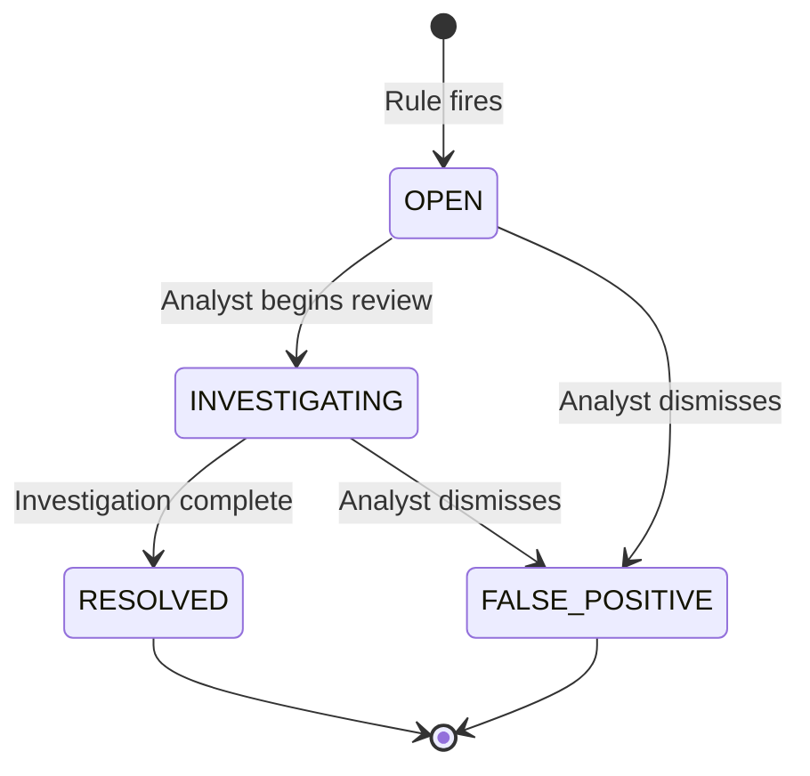
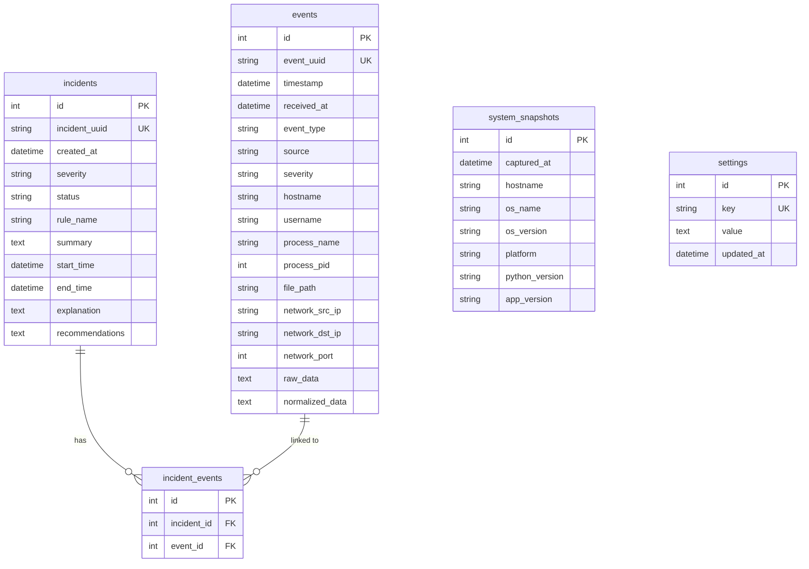

# Cyber Emergency Black Box — Design Document

**Document Version:** 1.1  
**Last Updated:** Phase 0 — Complete  
**Status:** Phase 0 complete. No application functionality has been implemented yet.

---

## 1. Overview

This document describes the architecture, component design, data flows, and key design decisions for the Cyber Emergency Black Box prototype. It is derived from `PROJECT_STRUCTURE.md` and `docs/REQUIREMENTS.md` and must remain consistent with both.

---

## 2. Architecture

The system follows a layered architecture with a single-process Python backend. All components run locally on one machine. There are no external services, no message queues, and no cloud dependencies.

```
┌─────────────────────────────────────────────────────────────┐
│                     PRESENTATION LAYER                      │
│              Web Dashboard (HTML/CSS/JS)                    │
│              served as static files by FastAPI              │
└──────────────────────────┬──────────────────────────────────┘
                           │ HTTP REST (fetch API)
┌──────────────────────────▼──────────────────────────────────┐
│                       API LAYER                             │
│              FastAPI  (routes + Pydantic schemas)           │
└──────────────────────────┬──────────────────────────────────┘
                           │ calls
┌──────────────────────────▼──────────────────────────────────┐
│                     SERVICE LAYER                           │
│   event_service  │  incident_service  │  rolling_buffer     │
└──────────────────┬───────────────────┬─────────────────────┘
                   │                   │
        ┌──────────▼──────┐   ┌────────▼────────┐
        │   DOMAIN LAYER   │   │  DOMAIN LAYER   │
        │  correlation/    │   │  evidence/      │
        │  interpreter/    │   │  reports/       │
        └──────────┬───────┘   └────────┬────────┘
                   │                    │
┌──────────────────▼────────────────────▼────────────────────┐
│                    DATABASE LAYER                           │
│       SQLAlchemy ORM  +  SQLite  (crud.py)                 │
└─────────────────────────────────────────────────────────────┘
        ▲                              ▲
        │ ingest                       │ read
┌───────┴──────────┐        ┌──────────┴──────────┐
│ Real Collectors  │        │      Simulator       │
│  (OS-specific)   │        │  (synthetic only)    │
└──────────────────┘        └─────────────────────┘
```

### Design Rationale

- **Single process**: Keeps the prototype simple and debuggable. No inter-process communication needed at this scale.
- **SQLite**: Zero-configuration, file-based, sufficient for single-endpoint workloads. The ORM (SQLAlchemy) allows a future migration to PostgreSQL by changing one connection string.
- **Vanilla JS frontend**: Avoids a build step. Students can read and understand the frontend without knowledge of React, Vue, or Webpack.
- **Rule-based correlation only**: Deterministic, explainable, and auditable. No model training data, no black-box inference.

---

## 3. Component Design

### 3.1 Collectors (`backend/collectors/`)

Each collector extends `BaseCollector` and implements two methods:

```python
class BaseCollector(ABC):
    @abstractmethod
    def collect(self) -> list[RawEvent]:
        """Collect raw events from the OS. Returns empty list if unsupported."""

    @abstractmethod
    def supported_platform(self) -> list[str]:
        """Return list of supported platform strings, e.g. ['windows', 'linux']."""
```

Collectors produce `RawEvent` objects — unvalidated, OS-specific data. The service layer normalizes these into the standard `Event` schema.

**Platform handling:** Before collecting, a collector checks `platform.system()` against its `supported_platform()` list. If the current platform is not supported, it logs a warning and returns `[]`.

### 3.2 Event Normalization (`backend/services/event_service.py`)

The normalization step converts any raw event (from a collector or the simulator) into the standard Pydantic `Event` model. Key responsibilities:

1. Validate required fields are present.
2. Assign a UUID if not already present.
3. Set `received_at` timestamp.
4. Assign severity based on event type and content if not already assigned.
5. Serialize `raw_data` and `normalized_data` to JSON strings for storage.
6. Call `crud.create_event()` to persist.

### 3.3 Rolling Buffer (`backend/services/rolling_buffer.py`)

The rolling buffer is a periodic cleanup service:

- Runs on a configurable interval (default: every 5 minutes).
- Queries for events older than the configured retention window (default: 30 minutes).
- Checks that no such event is linked to an incident (via `incident_events` table).
- Deletes events that are outside the retention window AND are not incident-linked.

This is a best-effort mechanism. Events generated while the application is not running are not captured.

### 3.4 Correlation Engine (`backend/correlation/engine.py`)

The engine maintains a registry of rule objects. On each evaluation cycle (triggered after event ingestion or on a timer):

1. Query recent events within the rule's configured time window.
2. Pass the event list to each registered rule's `evaluate()` method.
3. Collect any `IncidentCandidate` objects returned.
4. For each candidate, call `incident_service.create_incident()`.

```python
class BaseRule(ABC):
    rule_id: str
    rule_name: str
    default_severity: str
    time_window_seconds: int

    @abstractmethod
    def evaluate(self, events: list[Event]) -> IncidentCandidate | None:
        """Examine the event list. Return an IncidentCandidate or None."""
```

Rules receive the full event window and apply their own logic. They return `None` if no pattern is detected, or an `IncidentCandidate` with matched event IDs, explanation, and recommendations if a pattern is found.

**Deduplication:** The engine checks whether an incident for the same rule and overlapping event window already exists before creating a duplicate.

### 3.5 Incident Service (`backend/services/incident_service.py`)

Manages the full incident lifecycle:

- `create_incident(candidate)` → creates the incident record and links events.
- `update_status(incident_id, status)` → analyst status updates.
- `get_incident_with_events(incident_id)` → loads incident + all linked events.

### 3.6 Evidence Manager (`backend/evidence/manager.py`)

Called when an incident is ready for preservation:

1. Load all events linked to the incident from the database.
2. Load current system snapshot.
3. Call interpreter to generate `timeline.json`.
4. Write `events.json`, `timeline.json`, `system_info.json`, `README.txt` to `evidence/<incident_uuid>/`.
5. Compute SHA-256 of each file using `integrity.py`.
6. Write `manifest.json` with all hashes.

Files are written once. The manager never overwrites an existing evidence package.

### 3.7 Integrity Module (`backend/evidence/integrity.py`)

Two functions:

```python
def hash_file(path: Path) -> str:
    """Return SHA-256 hex digest of a file."""

def verify_package(evidence_dir: Path) -> dict[str, bool]:
    """Re-hash each file and compare against manifest.json. Returns per-file pass/fail."""
```

### 3.8 Log Interpreter (`backend/interpreter/timeline.py`)

Transforms stored events into structured, readable output:

```
Input:  list[Event] + IncidentRecord
Output: TimelineReport
```

`TimelineReport` structure:
- `incident_id`
- `generated_at`
- `confirmed_facts` — chronological list of plain-English event descriptions
- `detection_result` — which rule fired and what pattern it matched
- `interpretation` — what the pattern *may* indicate (carefully worded)
- `recommendations` — ordered list of next steps

The interpreter iterates over events sorted by timestamp and generates one sentence per event using templates per event type. It never adds events that are not in the input list.

### 3.9 FastAPI Application (`backend/main.py`)

- Initializes database on startup.
- Mounts static files from `frontend/` at `/`.
- Registers API routers under `/api/v1/`.
- Registers a `/health` endpoint.
- Uses a lifespan context manager for startup/shutdown logic.

### 3.10 Simulator (`simulator/runner.py`)

The simulator is a standalone Python script that can also be imported as a module.

```
python -m simulator.runner --scenario account_compromise
```

Flow:
1. Parse CLI arguments.
2. Load requested scenario module.
3. Call `scenario.generate()` → list of synthetic `RawEvent` objects.
4. For each event, call the same `event_service.ingest()` function used by real collectors.
5. Print progress to stdout.
6. Exit.

All simulator events carry `source = "SIMULATOR"` so they are distinguishable from real events in the database.

---

## 4. Data Flow

### 4.1 Normal Event Ingestion

```
Collector.collect()
    │
    ▼
RawEvent (dict)
    │
    ▼
event_service.normalize(raw_event)
    │  Validates fields, assigns UUID, sets received_at, sets severity
    ▼
Event (Pydantic model)
    │
    ▼
crud.create_event(db, event)
    │  Persists to SQLite events table
    ▼
correlation_engine.evaluate_recent()
    │  Runs all rules against recent event window
    ▼
IncidentCandidate (or None)
    │
    ▼ (if candidate)
incident_service.create_incident(candidate)
    │  Creates incident + incident_event links
    ▼
evidence_manager.export(incident)
    │  Writes evidence package
    ▼
integrity.hash_package()
    │  Writes manifest.json
    ▼
Done
```

### 4.2 Simulator Flow

```
python -m simulator.runner --scenario account_compromise
    │
    ▼
scenario.generate() → list[RawEvent]
    │  Synthetic events, source="SIMULATOR"
    ▼
(same pipeline as 4.1 from normalize step onward)
```

### 4.3 API Request — Get Incident Timeline

```
GET /api/v1/incidents/{id}/timeline
    │
    ▼
incidents router
    │
    ▼
incident_service.get_incident_with_events(id)
    │  Returns incident + linked events from DB
    ▼
interpreter.generate_timeline(incident, events)
    │  Returns TimelineReport
    ▼
JSON response to client
```

### 4.4 Evidence Export Flow

```
POST /api/v1/incidents/{id}/evidence
    │
    ▼
evidence_manager.export(incident_id)
    │
    ├── crud.get_events_for_incident(id)
    ├── interpreter.generate_timeline(...)
    ├── system_info.collect()
    ├── write events.json
    ├── write timeline.json
    ├── write system_info.json
    ├── write README.txt
    ├── integrity.hash_all_files()
    └── write manifest.json
    │
    ▼
Return package path and manifest summary
```

---

## 5. Database Relationships

```
events (1) ──────────── (N) incident_events (N) ──────────── (1) incidents
                              [incident_id FK]
                              [event_id FK]

incidents (1) ──── (0..N) evidence packages (filesystem, not a DB table)

system_snapshots  (independent, captured at startup and on evidence export)

settings          (key-value store for runtime configuration)
```

---

## 6. Event Pipeline Detail

```
Raw Data (dict / OS API response)
    │
    ▼ normalize()
┌─────────────────────────────────────────┐
│ event_uuid      = new UUID4             │
│ timestamp       = from raw or now()     │
│ received_at     = now()                 │
│ event_type      = mapped from raw type  │
│ source          = collector name        │
│ severity        = assigned by rules map │
│ hostname        = platform.node()       │
│ username        = from raw if present   │
│ process_name    = from raw if present   │
│ process_pid     = from raw if present   │
│ file_path       = from raw if present   │
│ network_src_ip  = from raw if present   │
│ network_dst_ip  = from raw if present   │
│ network_port    = from raw if present   │
│ raw_data        = JSON(original dict)   │
│ normalized_data = JSON(this object)     │
└─────────────────────────────────────────┘
    │
    ▼ crud.create_event()
SQLite events table
```

---

## 7. Correlation Pipeline Detail

```
Trigger: new event ingested OR periodic timer
    │
    ▼
Load recent events (last N seconds, configurable per rule)
    │
    ▼
For each rule in registry:
    rule.evaluate(events)
        │
        ├── Inspect event sequence
        ├── Check type patterns, time gaps, counts
        └── Return IncidentCandidate or None
    │
    ▼ (if IncidentCandidate)
Check for duplicate incident (same rule + overlapping events)
    │
    ▼ (if not duplicate)
incident_service.create_incident(candidate)
    ├── Insert incident row
    ├── Insert incident_event rows for each matched event
    └── Trigger evidence export
```

### Rule RULE-001 Logic (Possible Account Compromise)

```
Within time_window (default: 10 minutes):
    1. Find at least N failed LOGIN events (default N=3)
    2. Find at least 1 successful LOGIN event AFTER the last failed login
    3. Find at least 1 non-LOGIN event AFTER the successful login

If all three conditions are met → return IncidentCandidate(severity=HIGH)
```

### Rule RULE-002 Logic (Suspicious Process Activity)

```
Within time_window (default: 15 minutes):
    1. Find at least 1 PROCESS event with elevated or unusual attributes
    2. Find at least 1 FILE event AFTER the PROCESS event
    3. Find at least 1 NETWORK event AFTER the FILE event

If all three conditions are met → return IncidentCandidate(severity=MEDIUM)
```

### Rule RULE-003 Logic (Unusual File Activity)

```
Within time_window (default: 10 minutes):
    1. Find at least 1 PROCESS event
    2. Find at least N FILE events AFTER the PROCESS event (default N=5)

If both conditions are met → return IncidentCandidate(severity=MEDIUM)
```

---

## 8. Evidence Pipeline Detail

```
evidence_manager.export(incident_id)
    │
    ├── Create directory: evidence/<incident_uuid>/
    │       (fail safely if already exists)
    │
    ├── Write events.json
    │       [list of event dicts, exactly as in DB]
    │
    ├── Write timeline.json
    │       [TimelineReport from interpreter]
    │
    ├── Write system_info.json
    │       [hostname, OS, platform, Python version, export timestamp]
    │
    ├── Write README.txt
    │       [plain-text summary for non-technical reviewer]
    │
    └── Write manifest.json
            {
              "incident_id": "...",
              "exported_at": "ISO timestamp",
              "files": [
                {
                  "filename": "events.json",
                  "size_bytes": 4096,
                  "sha256": "abc123..."
                },
                ...
              ]
            }
```

---

## 9. Interpreter Pipeline Detail

```
interpreter.generate_timeline(incident, events)
    │
    ├── Sort events by timestamp ascending
    │
    ├── confirmed_facts = []
    │   For each event:
    │       template = EVENT_TEMPLATES[event.event_type]
    │       fact = template.format(event)
    │       confirmed_facts.append(fact)
    │
    ├── detection_result
    │       "Rule {rule_name} was triggered because: {rule explanation}"
    │
    ├── interpretation
    │       Template per rule: careful, non-definitive language
    │       "This sequence may indicate..."
    │       "The pattern is consistent with..."
    │
    └── recommendations
            Per-rule list of investigation steps
```

---

## 10. API Architecture

All API routes are prefixed with `/api/v1/`. Routes are organized into separate modules by resource.

```
FastAPI app
    │
    ├── /health                     — health_router
    ├── /api/v1/events              — events_router
    ├── /api/v1/incidents           — incidents_router
    ├── /api/v1/evidence            — evidence_router
    ├── /api/v1/statistics          — statistics_router
    └── /api/v1/system              — system_router
```

### Standard Response Envelope

```json
{
  "success": true,
  "data": { ... },
  "error": null,
  "meta": {
    "total": 100,
    "page": 1,
    "page_size": 20
  }
}
```

Errors:
```json
{
  "success": false,
  "data": null,
  "error": {
    "code": "NOT_FOUND",
    "message": "Incident 123 does not exist"
  }
}
```

---

## 11. Frontend Architecture

The frontend is a single-page application served as static files. There is no build step and no JavaScript framework.

```
index.html
    │
    ├── Loads style.css
    ├── Loads app.js (router + bootstrap)
    ├── Loads api.js (fetch wrapper)
    └── Each page module loaded on demand:
            overview.js
            events.js
            incidents.js
            investigation.js
            system.js
```

### Navigation

A simple hash-based router (`#overview`, `#events`, `#incidents`, `#investigation/<id>`, `#system`) renders the appropriate page module and fetches data via `api.js`.

### api.js

A thin wrapper around the browser `fetch` API. All calls go to `http://localhost:<PORT>/api/v1/...`. Handles JSON parsing and error extraction from the standard envelope format.

---

## 12. Configuration

All configuration is loaded from `.env` via `python-dotenv`. The application has sensible defaults for all values so it can run without a `.env` file.

| Key | Default | Description |
|---|---|---|
| `DATABASE_URL` | `sqlite:///./cebb.db` | SQLAlchemy database URL |
| `HOST` | `127.0.0.1` | Bind address |
| `PORT` | `8000` | HTTP port |
| `LOG_LEVEL` | `INFO` | Python logging level |
| `RETENTION_MINUTES` | `30` | Rolling buffer retention window |
| `EVIDENCE_DIR` | `./evidence` | Evidence output directory |
| `APP_VERSION` | `0.1.0` | Application version string |

---

## 13. Mermaid Diagrams

### 13.1 High-Level Data Flow



### 13.2 Incident Lifecycle



### 13.3 Database Entity Relationships



---

## 14. Security Design Decisions

- **No outbound network calls**: The backend never initiates connections to external services.
- **Read-only collectors**: Collectors use OS read APIs only. No write operations.
- **Immutable evidence**: `evidence_manager.export()` checks whether a package already exists and refuses to overwrite it.
- **Local-only by default**: FastAPI is bound to `127.0.0.1` by default. Changing to `0.0.0.0` exposes the unauthenticated dashboard to the network and must be explicit.
- **No authentication in prototype**: Noted as a known limitation (LIM-007). Production deployment would require authentication middleware.

---

## 15. Update Log

| Date | Phase | Change |
|---|---|---|
| Phase 0 | Specification | Initial design document created. |

---

*This document must agree with `PROJECT_STRUCTURE.md` and `docs/REQUIREMENTS.md` at all times.*
